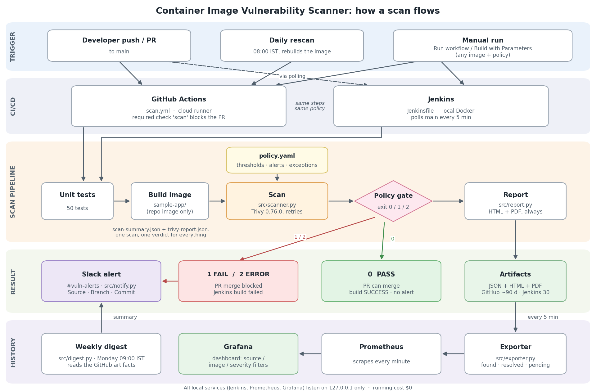

# Container Image Vulnerability Scanner

A **shift-left security** tool: every container image is scanned for known vulnerabilities **before** it can be merged or shipped, and the build is blocked when the image breaks the security policy. It wraps the open-source scanner [Trivy](https://github.com/aquasecurity/trivy) with a policy gate, reports, Slack alerts, approved exceptions and a trend dashboard, and runs identically on **GitHub Actions** and **Jenkins**. Running cost: **$0**.



## Contents
- [What it does](#what-it-does)
- [Quick start](#quick-start)
- [How the gate decides](#how-the-gate-decides)
- [Repository layout](#repository-layout)
- [Documentation](#documentation)
- [Testing](#testing)
- [Project history](#project-history)

## What it does

| Goal (from the brief) | How it is met |
|---|---|
| **Scan images** for known CVEs | `src/scanner.py` runs Trivy 0.76.0 (pinned) and counts findings by severity |
| **Gate CI/CD** on severity | `policy.yaml` thresholds (CRITICAL 0, HIGH 10). GitHub Actions blocks the PR through the required `scan` check; Jenkins fails the build |
| **Reports** | `src/report.py`: HTML and PDF report per scan, plus the raw Trivy JSON and a `scan-summary.json` verdict |
| **Notifications** | `src/notify.py`: Slack alert on FAIL or ERROR only (passing scans are silent), `@channel` for CRITICAL, with the source system, branch and commit. `src/digest.py`: weekly Slack summary |
| **Dashboard** | `src/exporter.py` → Prometheus → Grafana: open, found and resolved vulnerabilities over time, filterable by source, image and severity |
| **Exceptions** | Approved known CVEs in `policy.yaml`, each with reason, approver and an expiry of at most 90 days; still reported, but not counted while active |
| **Rescans** | Daily scheduled rescan (08:00 IST) and an on-demand **Run workflow**; each rescan rebuilds the image |
| **Reliability** | Retries for Trivy, the image build and Slack; any tool or configuration problem is an ERROR, never a silent pass |

## Quick start

Prerequisites: Ubuntu on WSL2 (or Linux), Docker Desktop with WSL integration, Git, Python 3.10+.

Fork the repository first (see [docs/setup.md](docs/setup.md)), then:

```bash
git clone https://github.com/<you>/<your-repo>.git vuln-scanner
cd vuln-scanner
./deploy.sh check      # read-only check of everything below
./deploy.sh all        # venv + packages, Trivy, PDF libraries, tests, Jenkins, monitoring
```

Then scan an image locally:

```bash
source .venv/bin/activate
python src/scanner.py python:3.9-slim --output-dir reports   # FAIL: CRITICAL 6
python src/report.py --input-dir reports --pdf                # reports/report.html + report.pdf
```

`deploy.sh` is safe to run again: it skips what is already done, keeps existing `.env` values and never deletes Docker volumes. A few one-time steps (Jenkins setup wizard and job, Slack webhook, GitHub secret and branch ruleset) are manual: see [docs/setup.md](docs/setup.md).

| Service | URL |
|---|---|
| Jenkins | http://localhost:8080 |
| Grafana dashboard | http://localhost:3000 (user `admin`) |
| Prometheus | http://localhost:9090 |

All three listen on `127.0.0.1` only: this is a local lab setup.

## How the gate decides

1. `scanner.py` runs Trivy once and writes `trivy-report.json` (raw findings) and `scan-summary.json` (the verdict). Reports, alerts, the digest and the dashboard all read these files; nothing re-decides pass or fail.
2. Findings covered by an **active** exception are reported but not counted.
3. A severity **fails** when its count **exceeds** its limit (`HIGH: 10` allows 10, blocks 11).
4. The exit code tells CI/CD what happened:

| Exit | Meaning | GitHub Actions | Jenkins | Slack |
|---|---|---|---|---|
| 0 | PASS: policy satisfied | check green, PR can merge | build SUCCESS | none |
| 1 | FAIL: policy breached | check red, merge blocked | "Blocked by policy" | 🔴/🟠 alert, `@channel` for CRITICAL |
| 2 | ERROR: tool or config problem, no verdict | check red | "Tool error, investigate" | ⚠️ "Scan did not complete" |

A broken policy file, a malformed exception, a missing Trivy or an unreachable registry is always exit 2, never a pass.

## Repository layout

```
src/                 scanner.py  report.py  notify.py  digest.py  exporter.py  templates/
sample-app/          Dockerfile  app.py            the image under test (python:3.13-alpine)
policy.yaml          thresholds, Slack mentions, exceptions
tests/               unit tests + demo policies for the exception tests
Jenkinsfile          Jenkins pipeline (parameters SCAN_IMAGE, POLICY_FILE)
.github/workflows/   scan.yml (gate, rescans, manual runs)  weekly-digest.yml
ci/jenkins/          local Jenkins image and compose file
monitoring/          exporter, Prometheus and Grafana (compose, dashboard, backfill)
deploy.sh            setup and start/stop script
requirements.txt     pinned Python packages
docs/                the documentation below
```

## Documentation

| Document | Contents |
|---|---|
| [docs/setup.md](docs/setup.md) | Prerequisites, `deploy.sh`, and the one-time manual steps |
| [docs/usage.md](docs/usage.md) | Local scans, reports, PR gate, rescans, manual runs, Jenkins parameters, digest, dashboard |
| [docs/configuration.md](docs/configuration.md) | `policy.yaml` (thresholds, alerts, exceptions), secrets, environment files |
| [docs/troubleshooting.md](docs/troubleshooting.md) | Common problems and fixes, known limitations |
| [docs/maintenance.md](docs/maintenance.md) | Token renewals, version pins, routine checks |
| [docs/testing.md](docs/testing.md) | Unit tests and the cross-CI test matrix with results |
| [docs/cost.md](docs/cost.md) | Current $0 setup and what production would cost |
| [docs/beta-testing.md](docs/beta-testing.md) | Guide for beta testers: setup, tasks, how to report |

## Testing

```bash
python -m unittest discover -s tests     # 50 tests; also run by both pipelines before scanning
```

The same five-case matrix (pass, policy fail, exceptions pass, expired exception, broken exception) was run on Jenkins and GitHub Actions with identical results: see [docs/testing.md](docs/testing.md).

## Project history

| Sprint | Delivered |
|---|---|
| 1 | Trivy setup, `scanner.py`, `policy.yaml`, exit-code contract |
| 2 | GitHub Actions gate with branch ruleset; local Jenkins pipeline with parameters |
| 3 | Single-scan JSON outputs, HTML/PDF report, Slack alerts by severity, weekly digest |
| 4 | Prometheus exporter, Grafana dashboard with filters, history backfill, usability test |
| 5 | Approved exceptions with expiry, retries, daily and on-demand rescans, exception tracking |
| 6 | Folder structure, pinned requirements, `deploy.sh`, CI parity and test matrix, alert source label, documentation, beta feedback |

HeroVired project by Kamal Vasvani.
